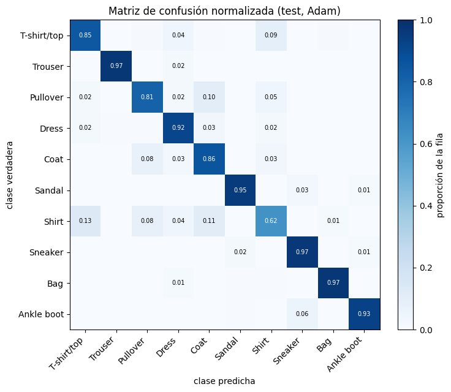
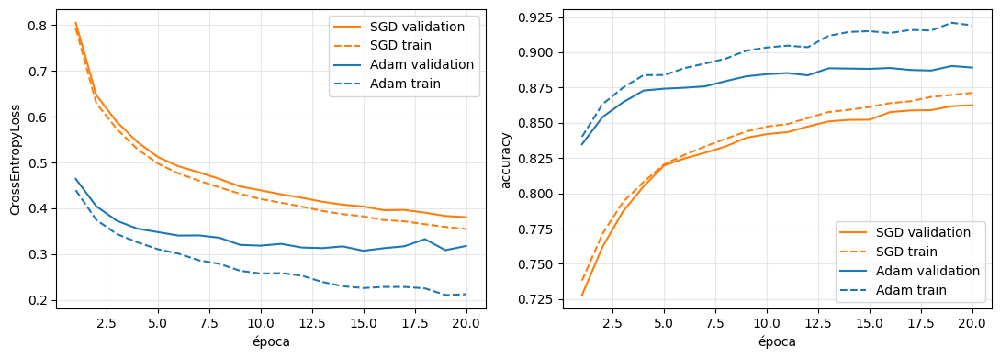
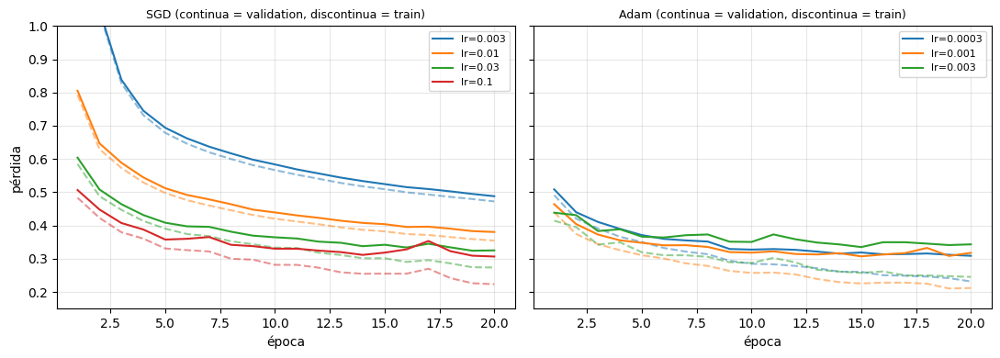
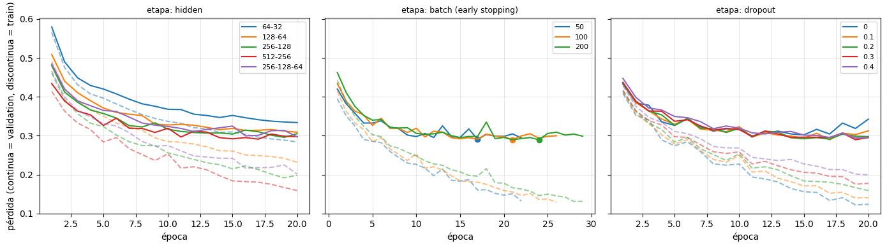
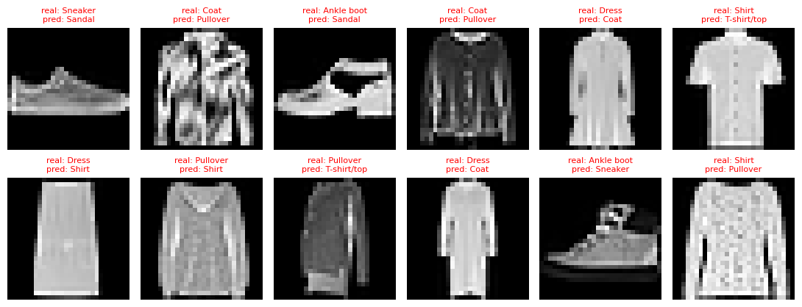

# Clasificador de Fashion-MNIST con PyTorch

[English](README.md) · **Español**

Una red neuronal completamente conectada (MLP) que mira una imagen de ropa de 28×28 píxeles en escala de grises y decide **a cuál de 10 categorías pertenece**. La hice en PyTorch para el segundo trabajo práctico (TP2) de un curso de Redes Neuronales en 2026. Partí de la configuración base del curso, comparé los optimizadores SGD y Adam y después hice una **búsqueda de hiperparámetros por etapas**, eligiendo siempre con un conjunto de validación y usando test una sola vez.

| | Configuración | Accuracy en validation | Accuracy en test |
|---|---|---|---|
| Base | Adam, lr 0,001, ocultas 128-64, dropout 0,2 | 88,9 % | 88,4 % |
| **Después de la búsqueda** | **Adam, lr 0,0003, ocultas 512-256, dropout 0,2** | **89,6 %** | **88,9 %** |



## El problema

[Fashion-MNIST](https://github.com/zalandoresearch/fashion-mnist) tiene 70.000 imágenes en escala de grises de 10 tipos de prendas: T-shirt/top, Trouser, Pullover, Dress, Coat, Sandal, Shirt, Sneaker, Bag y Ankle boot. Es clasificación supervisada: cada imagen viene con su etiqueta y la red aprende a predecirla.

| Conjunto | Imágenes | Para qué se usa |
|---|---|---|
| Train | 50.000 | ajustar los pesos |
| Validation | 10.000 | comparar optimizadores e hiperparámetros, elegir el modelo |
| Test | 10.000 (oficial) | evaluación final, una sola vez |

El corte 50.000 / 10.000 sale del conjunto de entrenamiento oficial con una semilla fija. Los píxeles se normalizan a [-1, 1].

## Modelo y entrenamiento

```
(B,1,28,28) → Flatten → [Linear → ReLU → Dropout] × cantidad de capas ocultas → Linear → 10 logits
```

- **Pérdida:** `CrossEntropyLoss`. La red devuelve logits sin Softmax, porque la pérdida ya aplica log-softmax adentro.
- **Base:** capas ocultas 128-64 (109.386 parámetros), dropout 0,2, mini-batches de 100, 20 épocas, semilla 42.
- **Modelo final:** capas ocultas 512-256 (535.818 parámetros), Adam con lr 0,0003, el resto igual.
- El dataset se precarga en memoria como tensores, así cada época es unas 10 veces más rápida.

## Resultados

Todos los números salen de las notebooks, ejecutadas en Google Colab con GPU T4 y semilla 42.

### 1. Base: SGD contra Adam (elegido con validation)

| Optimizador | Learning rate | Valid loss | Valid accuracy |
|---|---|---|---|
| SGD | 0,01 | 0,381 | 86,2 % |
| **Adam** | **0,001** | **0,318** | **88,9 %** |

Adam converge mucho más rápido: después de una época ya está en 83 % en validation, mientras SGD está en 73 %. Repitiendo con las semillas 0, 1 y 2 la diferencia se mantiene (SGD 86,01 ± 0,23 %, Adam 88,95 ± 0,41 %), así que no es casualidad. Pero SGD con lr 0,01 no había terminado de aprender: con 60 épocas llega a 88,6 %, y con lr 0,05 llega a 88,6 % en 20 épocas.



### 2. Búsqueda de hiperparámetros por etapas

Probar todas las combinaciones serían cientos de entrenamientos, así que la búsqueda va por etapas ([notebook](notebooks/02_grilla_hiperparametros.ipynb), [script](src/grid.py)):

1. **Optimizador y learning rate juntos**, porque el buen learning rate depende del optimizador. Cada optimizador tiene su propio rango.
2. **Capas ocultas → batch → dropout**, cambiando un hiperparámetro por vez. Un valor nuevo se adopta sólo si le gana a la configuración actual por más de **0,3 puntos** de accuracy en validation, un poco más que la variación entre semillas.
3. En la etapa del batch cada corrida usa **early stopping** (hasta 50 épocas, paciencia 5 sobre la pérdida de validación) y se compara en su mejor época. Un batch más grande hace menos actualizaciones de pesos por época, así que con 20 épocas fijas la comparación no sería pareja.

**Etapa 1: optimizador y learning rate** (ocultas 128-64, dropout 0,2, batch 100, 20 épocas)

| Optimizador | lr | Valid accuracy | Valid loss | Brecha (loss valid − train) | Mejor época |
|---|---|---|---|---|---|
| SGD | 0,003 | 82,7 % | 0,488 | 0,016 | 20 |
| SGD | 0,01 | 86,2 % | 0,381 | 0,026 | 20 |
| SGD | 0,03 | 88,4 % | 0,325 | 0,051 | 19 |
| SGD | 0,1 | 89,0 % | 0,307 | 0,083 | 20 |
| **Adam** | **0,0003** | **89,1 %** | **0,309** | **0,077** | **20** |
| Adam | 0,001 | 88,9 % | 0,318 | 0,106 | 15 |
| Adam | 0,003 | 88,2 % | 0,343 | 0,098 | 15 |



**Etapas 2 a 4** (partiendo de Adam, lr 0,0003)

| Etapa | Valor | Valid accuracy | Valid loss | Brecha | Mejor época |
|---|---|---|---|---|---|
| Capas ocultas | 64-32 | 88,1 % | 0,334 | 0,050 | 20 |
| | 128-64 | 89,1 % | 0,309 | 0,077 | 20 |
| | 256-128 | 89,1 % | 0,305 | 0,107 | 19 |
| | **512-256** | **89,6 %** | **0,298** | **0,139** | **17** |
| | 256-128-64 | 89,3 % | 0,297 | 0,095 | 20 |
| Batch (early stopping) | 50 | 89,9 % | 0,290 | 0,130 | 17 |
| | **100** | **89,9 %** | **0,290** | **0,134** | **21** |
| | 200 | 89,9 % | 0,289 | 0,143 | 24 |
| Dropout | 0 | 89,3 % | 0,343 | 0,219 | 11 |
| | 0,1 | 89,5 % | 0,313 | 0,172 | 17 |
| | **0,2** | **89,6 %** | **0,298** | **0,139** | **17** |
| | 0,3 | 89,5 % | 0,295 | 0,118 | 19 |
| | 0,4 | 89,6 % | 0,295 | 0,096 | 19 |



Lo que muestra la búsqueda:

- **SGD mejora a medida que sube el learning rate**; con 0,003 y 0,01 sigue mejorando en la época 20. **Adam anda mejor con lr chico**: con 0,001 y 0,003 su pérdida de validación toca el mínimo en la época 15 y después sobreajusta. Los tres mejores (Adam 0,0003, SGD 0,1 y Adam 0,001) están dentro de 0,2 puntos, que es del orden de la variación entre semillas.
- **Capas ocultas:** 512-256 es el único cambio que pasa el umbral (+0,5 puntos), pero también es la que más sobreajusta (brecha 0,139). La red de tres capas 256-128-64 logra casi la misma pérdida de validación con mucha menos brecha.
- **El batch casi no influye:** con early stopping los tres empatan en 89,9 %. Lo que cambia es cuántas épocas necesita cada uno.
- **Dropout:** la accuracy queda igual de 0,1 a 0,4, pero la brecha baja de 0,17 a 0,10. Sin dropout la red sobreajusta claramente (brecha 0,22, mejor época 11). Dropout 0,3 o 0,4 sería una elección razonable para sobreajustar menos aunque no gane por accuracy.
- **Advertencia:** al encadenar etapas, cada una depende de lo que se eligió antes (el mejor dropout podría ser otro con otra arquitectura). Es una búsqueda simple y fácil de explicar, no una garantía de encontrar la mejor combinación posible.

### 3. Evaluación final sobre test

La configuración final (Adam, lr 0,0003, ocultas 512-256, dropout 0,2, batch 100, 20 épocas) se evaluó **una sola vez** sobre las 10.000 imágenes de test:

| | Base | Final |
|---|---|---|
| Test loss | 0,333 | 0,325 |
| **Test accuracy** | 88,4 % | **88,9 %** |

### 4. ¿Qué clases cuestan más? (modelo base)

| Clase | Accuracy | Clase | Accuracy |
|---|---|---|---|
| Trouser | 97,0 % | Ankle boot | 93,2 % |
| Bag | 96,9 % | Dress | 91,6 % |
| Sneaker | 96,6 % | Coat | 85,7 % |
| Sandal | 95,5 % | T-shirt/top | 84,5 % |
| | | Pullover | 80,5 % |
| | | **Shirt** | **62,3 %** |

Los errores tienen sentido visual: casi todos son entre prendas de la parte de arriba del cuerpo. Las confusiones más grandes son **Shirt → T-shirt/top (12,9 %)**, Shirt → Coat (11,2 %) y Pullover → Coat (10,5 %). Calzado, bolsos y pantalones casi no se confunden.



## Estructura del repositorio

```
├── notebooks/
│   ├── 01_clasificador_base.ipynb        # base: SGD vs Adam, test, análisis de errores, experimentos de a uno
│   └── 02_grilla_hiperparametros.ipynb   # búsqueda de hiperparámetros por etapas y test final
├── src/
│   ├── model.py                          # FashionMLP con cualquier cantidad de capas ocultas
│   ├── train.py                          # entrena una configuración, evalúa en test y guarda figuras
│   └── grid.py                           # la búsqueda por etapas como script
├── images/                               # figuras de este README
└── requirements.txt
```

Las notebooks y las figuras están en español, el idioma del curso. El código de `src/` está en inglés.

## Cómo correrlo

```bash
pip install -r requirements.txt

# Opción 1: las notebooks (mejor en Google Colab con GPU: Runtime → Change runtime type → T4 GPU)
jupyter notebook notebooks/

# Opción 2: los scripts (descargan Fashion-MNIST en data/ la primera vez)
python src/train.py                               # configuración final
python src/train.py --hidden 128 64 --lr 1e-3     # la base
python src/train.py --optimizer SGD --lr 0.1
python src/train.py --epochs 50 --patience 5      # con early stopping
python src/grid.py                                # la búsqueda completa (~10 min en GPU T4)
```

`train.py` imprime las métricas de cada época, la accuracy de test por clase y las confusiones más grandes, y guarda las curvas, la matriz de confusión y los pesos en `outputs/`.

**Reproducibilidad:** todo lo aleatorio (corte de los datos, pesos iniciales, orden de los mini-batches, máscaras de dropout) queda fijado por la semilla. GPU y CPU usan rutinas numéricas distintas, así que en CPU los números cambian un poco (en la tercera o cuarta cifra).

## Lo que aprendí

- La red devuelve logits y `CrossEntropyLoss` se encarga del softmax; agregar Softmax al modelo lo aplicaría dos veces.
- Las decisiones se toman con validation y test se usa una sola vez al final. Si no, el resultado de test deja de ser una estimación honesta.
- El learning rate se ajusta **junto** con el optimizador: SGD parecía mucho peor que Adam con su lr por defecto, pero con lr 0,1 queda a la par, dentro del ruido.
- Una sola corrida no alcanza para comparar: diferencias de 0,2–0,4 puntos son del tamaño de la variación entre semillas.
- La accuracy no cuenta todo. El dropout casi no cambió la accuracy pero achicó la brecha entre la pérdida de train y la de validation en torno a un 40 %, y la matriz de confusión muestra que casi todos los errores son entre camisas, remeras, buzos y abrigos.
