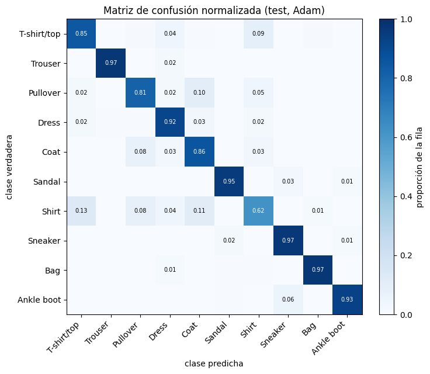
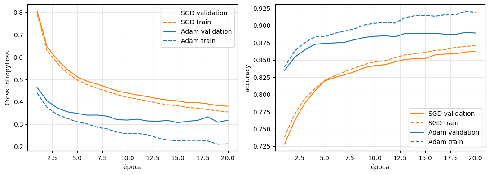
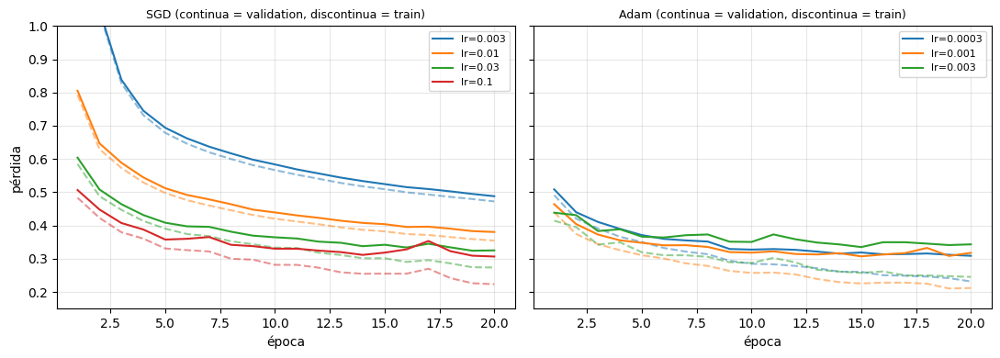
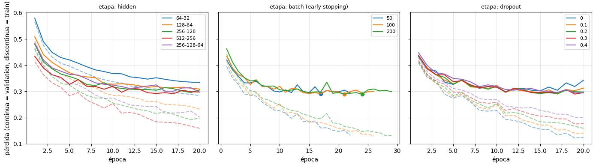
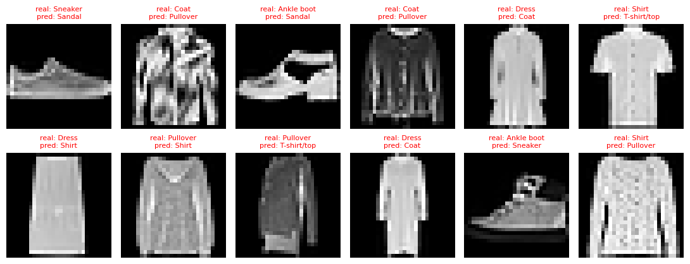

# Fashion-MNIST classifier with PyTorch

**English** · [Español](README.es.md)

A fully connected neural network (MLP) that looks at a 28×28 grayscale image of a clothing item and decides **which of 10 categories it belongs to**. I built it in PyTorch for the second assignment (TP2) of a Neural Networks course in 2026. I started from the course's baseline, compared the SGD and Adam optimizers, and then ran a **staged hyperparameter search**, always choosing on a validation set and touching the test set only once.

| | Configuration | Validation accuracy | Test accuracy |
|---|---|---|---|
| Baseline | Adam, lr 0.001, hidden 128-64, dropout 0.2 | 88.9 % | 88.4 % |
| **After the search** | **Adam, lr 0.0003, hidden 512-256, dropout 0.2** | **89.6 %** | **88.9 %** |



## The problem

[Fashion-MNIST](https://github.com/zalandoresearch/fashion-mnist) has 70,000 grayscale images of 10 kinds of clothing: T-shirt/top, Trouser, Pullover, Dress, Coat, Sandal, Shirt, Sneaker, Bag and Ankle boot. This is supervised classification: every image comes with its label and the network learns to predict it.

| Split | Images | Used for |
|---|---|---|
| Train | 50,000 | fitting the weights |
| Validation | 10,000 | comparing optimizers and hyperparameters, choosing the model |
| Test | 10,000 (official) | final evaluation, once |

The 50,000 / 10,000 split comes from the official training set with a fixed seed. Pixels are scaled to [-1, 1].

## Model and training

```
(B,1,28,28) → Flatten → [Linear → ReLU → Dropout] × number of hidden layers → Linear → 10 logits
```

- **Loss:** `CrossEntropyLoss`. The network outputs logits without Softmax, because the loss already applies log-softmax internally.
- **Baseline:** hidden layers 128-64 (109,386 parameters), dropout 0.2, mini-batches of 100, 20 epochs, seed 42.
- **Final model:** hidden layers 512-256 (535,818 parameters), Adam with lr 0.0003, everything else the same.
- The dataset is preloaded into memory as tensors, which makes each epoch about 10 times faster.

## Results

All numbers come from the notebooks, run on a Google Colab T4 GPU with seed 42.

### 1. Baseline: SGD vs Adam (chosen on validation)

| Optimizer | Learning rate | Valid loss | Valid accuracy |
|---|---|---|---|
| SGD | 0.01 | 0.381 | 86.2 % |
| **Adam** | **0.001** | **0.318** | **88.9 %** |

Adam converges much faster: after one epoch it is already at 83 % on validation, while SGD is at 73 %. Repeating with seeds 0, 1 and 2 the gap holds (SGD 86.01 ± 0.23 %, Adam 88.95 ± 0.41 %), so it is not luck. But SGD with lr 0.01 had not finished learning: with 60 epochs it reaches 88.6 %, and with lr 0.05 it reaches 88.6 % in 20 epochs.



### 2. Hyperparameter search in stages

Testing every combination would take hundreds of runs, so the search goes in stages ([notebook](notebooks/02_grilla_hiperparametros.ipynb), [script](src/grid.py)):

1. **Optimizer and learning rate together**, because a good learning rate depends on the optimizer. Each optimizer gets its own range.
2. **Hidden layers → batch size → dropout**, changing one hyperparameter at a time. A new value is kept only if it beats the current configuration by more than **0.3 points** of validation accuracy, which is a bit more than the variation between seeds.
3. In the batch-size stage every run uses **early stopping** (up to 50 epochs, patience 5 on validation loss) and is compared at its best epoch. A bigger batch means fewer weight updates per epoch, so with a fixed 20 epochs the comparison would not be fair.

**Stage 1: optimizer and learning rate** (hidden 128-64, dropout 0.2, batch 100, 20 epochs)

| Optimizer | lr | Valid accuracy | Valid loss | Gap (valid − train loss) | Best epoch |
|---|---|---|---|---|---|
| SGD | 0.003 | 82.7 % | 0.488 | 0.016 | 20 |
| SGD | 0.01 | 86.2 % | 0.381 | 0.026 | 20 |
| SGD | 0.03 | 88.4 % | 0.325 | 0.051 | 19 |
| SGD | 0.1 | 89.0 % | 0.307 | 0.083 | 20 |
| **Adam** | **0.0003** | **89.1 %** | **0.309** | **0.077** | **20** |
| Adam | 0.001 | 88.9 % | 0.318 | 0.106 | 15 |
| Adam | 0.003 | 88.2 % | 0.343 | 0.098 | 15 |



**Stages 2 to 4** (starting from Adam, lr 0.0003)

| Stage | Value | Valid accuracy | Valid loss | Gap | Best epoch |
|---|---|---|---|---|---|
| Hidden layers | 64-32 | 88.1 % | 0.334 | 0.050 | 20 |
| | 128-64 | 89.1 % | 0.309 | 0.077 | 20 |
| | 256-128 | 89.1 % | 0.305 | 0.107 | 19 |
| | **512-256** | **89.6 %** | **0.298** | **0.139** | **17** |
| | 256-128-64 | 89.3 % | 0.297 | 0.095 | 20 |
| Batch (early stopping) | 50 | 89.9 % | 0.290 | 0.130 | 17 |
| | **100** | **89.9 %** | **0.290** | **0.134** | **21** |
| | 200 | 89.9 % | 0.289 | 0.143 | 24 |
| Dropout | 0 | 89.3 % | 0.343 | 0.219 | 11 |
| | 0.1 | 89.5 % | 0.313 | 0.172 | 17 |
| | **0.2** | **89.6 %** | **0.298** | **0.139** | **17** |
| | 0.3 | 89.5 % | 0.295 | 0.118 | 19 |
| | 0.4 | 89.6 % | 0.295 | 0.096 | 19 |



What the search shows:

- **SGD improves as the learning rate grows**; with 0.003 and 0.01 it is still improving at epoch 20. **Adam prefers a small learning rate**: with 0.001 and 0.003 its validation loss bottoms out at epoch 15 and then it overfits. The top three (Adam 0.0003, SGD 0.1, Adam 0.001) are within 0.2 points, which is about the seed-to-seed noise.
- **Hidden layers:** 512-256 is the only change that passes the threshold (+0.5 points), but it also overfits the most (gap 0.139). The three-layer 256-128-64 network gets almost the same validation loss with a much smaller gap.
- **Batch size barely matters:** with early stopping all three tie at 89.9 %. What changes is how many epochs each one needs.
- **Dropout:** accuracy stays the same from 0.1 to 0.4, but the gap shrinks from 0.17 to 0.10. Without dropout the network clearly overfits (gap 0.22, best epoch 11). Dropout 0.3 or 0.4 would be a reasonable choice for less overfitting even if it does not win on accuracy.
- **Caveat:** chaining stages means each one depends on earlier choices (the best dropout could be different for another architecture). It is a simple, explainable search, not a guarantee of the best possible combination.

### 3. Final evaluation on test

The final configuration (Adam, lr 0.0003, hidden 512-256, dropout 0.2, batch 100, 20 epochs) was evaluated **once** on the 10,000 test images:

| | Baseline | Final |
|---|---|---|
| Test loss | 0.333 | 0.325 |
| **Test accuracy** | 88.4 % | **88.9 %** |

### 4. Which classes are hard? (baseline model)

| Class | Accuracy | Class | Accuracy |
|---|---|---|---|
| Trouser | 97.0 % | Ankle boot | 93.2 % |
| Bag | 96.9 % | Dress | 91.6 % |
| Sneaker | 96.6 % | Coat | 85.7 % |
| Sandal | 95.5 % | T-shirt/top | 84.5 % |
| | | Pullover | 80.5 % |
| | | **Shirt** | **62.3 %** |

The errors make visual sense: almost all of them are between upper-body garments. The biggest confusions are **Shirt → T-shirt/top (12.9 %)**, Shirt → Coat (11.2 %) and Pullover → Coat (10.5 %). Footwear, bags and trousers are almost never confused.



## Repository structure

```
├── notebooks/
│   ├── 01_clasificador_base.ipynb        # baseline: SGD vs Adam, test, error analysis, one-at-a-time experiments
│   └── 02_grilla_hiperparametros.ipynb   # staged hyperparameter search and final test
├── src/
│   ├── model.py                          # FashionMLP with any number of hidden layers
│   ├── train.py                          # train one configuration, evaluate on test, save figures
│   └── grid.py                           # the staged search as a script
├── images/                               # figures used in this README
└── requirements.txt
```

The notebooks and figure labels are in Spanish, the language of the course. The code in `src/` is in English.

## How to run it

```bash
pip install -r requirements.txt

# Option 1: the notebooks (best on Google Colab with a GPU: Runtime → Change runtime type → T4 GPU)
jupyter notebook notebooks/

# Option 2: the scripts (Fashion-MNIST is downloaded to data/ the first time)
python src/train.py                               # final configuration
python src/train.py --hidden 128 64 --lr 1e-3     # the baseline
python src/train.py --optimizer SGD --lr 0.1
python src/train.py --epochs 50 --patience 5      # with early stopping
python src/grid.py                                # the full staged search (~10 min on a T4 GPU)
```

`train.py` prints the metrics for every epoch, the test accuracy per class and the largest confusions, and saves the curves, the confusion matrix and the weights in `outputs/`.

**Reproducibility:** everything random (data split, initial weights, mini-batch order, dropout masks) is fixed by the seed. GPU and CPU use different floating-point kernels, so on CPU the numbers change slightly (in the third or fourth digit).

## What I learned

- The network returns logits and `CrossEntropyLoss` takes care of the softmax; adding Softmax to the model would apply it twice.
- Decisions are made on validation and test is used once at the end. Otherwise the test score stops being an honest estimate.
- The learning rate has to be tuned **together** with the optimizer: SGD looked much worse than Adam at its default lr, but with lr 0.1 it is within noise of Adam.
- One run is not enough to compare: differences of 0.2–0.4 points are the size of the seed-to-seed variation.
- Accuracy is not the whole story. Dropout barely changed accuracy but shrank the gap between train and validation loss by about 40 %, and the confusion matrix shows that nearly all errors are between shirts, T-shirts, pullovers and coats.
